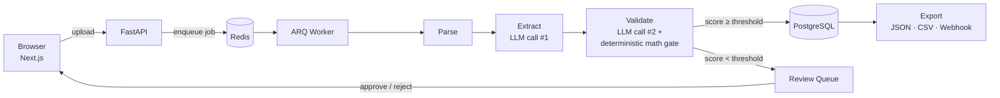
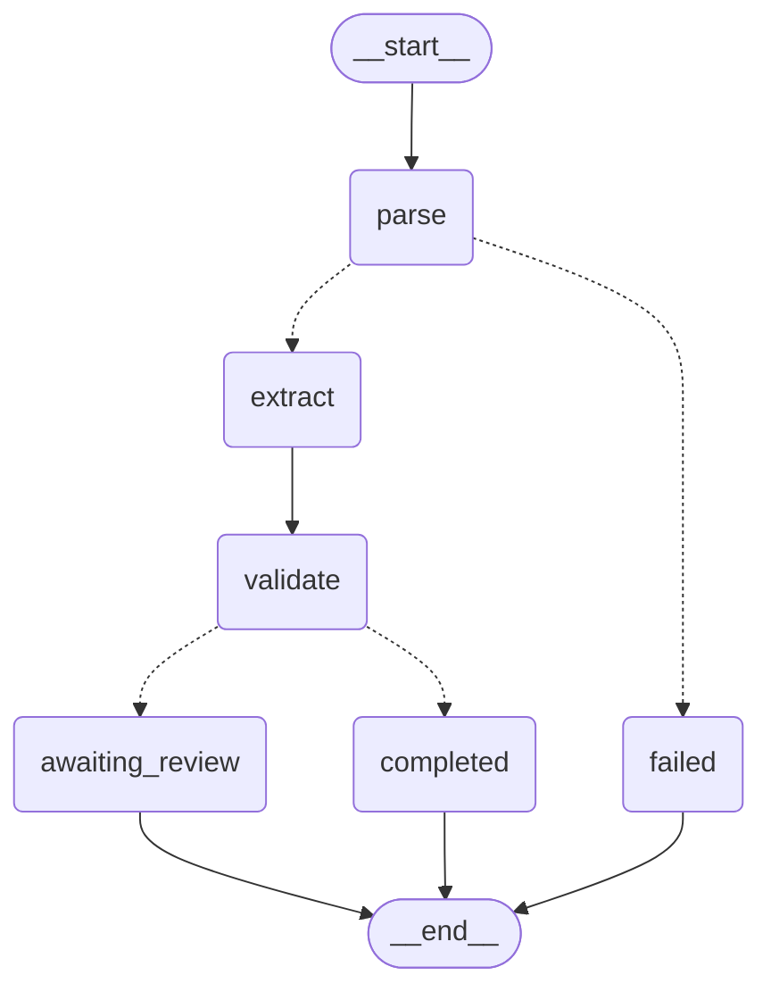

# docflow-agent

[](https://github.com/Pavanmanikanta98/docflow-agent/actions/workflows/ci.yml)
[](https://github.com/Pavanmanikanta98/docflow-agent/actions/workflows/eval-gate.yml)

Document processing pipeline that extracts structured data from invoices and contracts, scores each field against the source text, and holds low-confidence documents for human review before export.

**Live demo:** https://docflow-agent.vercel.app (the API sleeps when idle, so the first load can take about a minute) · **Source:** this repo · _Walkthrough video: not recorded yet._

---

## What It Does

Upload a PDF or image → the backend queues it → a LangGraph pipeline extracts text and typed fields → low-confidence documents wait for human review → export as JSON, CSV, or webhook.

```
Invoice / Contract (PDF, PNG, JPEG)
       ↓
  Parse        — PDFs: PyMuPDF → pdfplumber → Tesseract OCR; images: Tesseract OCR
       ↓
  Extract      — LLM call #1: pydantic-ai structured output, one schema per document type
       ↓
  Validate     — LLM call #2: scores each extracted field against the raw text
       ↓
  Route        — score ≥ CONFIDENCE_THRESHOLD → completed, otherwise → awaiting review
       ↓
  Human Review — approve or reject in the UI
       ↓
  Export       — JSON, CSV, or webhook
```

### Architecture



The API and worker are two processes reading the same queue, deployable as one
container (`backend/start.sh all`, for free-tier hosts with no background-worker
tier) or two separate ones. Either way, an upload request never runs the pipeline
itself — it only enqueues a job and returns.

**The LangGraph pipeline itself**, generated directly from the compiled graph
(`pipeline.get_graph().draw_mermaid()` in `backend/core/pipeline.py`) rather than
hand-drawn, so it can't drift from the actual routing:



```bash
# Reproduce this diagram:
uv run python -c "from backend.core.pipeline import pipeline; print(pipeline.get_graph().draw_mermaid())"
```

---

## Key Features

- **LangGraph pipeline** — typed shared state and conditional routing (failed / review / completed)
- **Structured extraction** — pydantic-ai validates every LLM output against a typed schema
- **Human-in-the-loop** — documents below the confidence threshold wait for a reviewer
- **OCR fallback** — scanned PDFs fall through to Tesseract; PNG/JPEG uploads go straight to OCR
- **Async processing** — uploads return immediately; an ARQ worker processes the queue
- **Swappable LLM** — Groq by default; OpenAI or Ollama via `LLM_PROVIDER`
- **Evaluation harness** — 32 hand-labelled cases (20 clean, 12 adversarial) scored with deterministic field matchers
- **Plugin architecture** — each document type is one file in `backend/plugins/`

---

## Tech Stack

| Layer | Technology |
|---|---|
| Orchestration | LangGraph |
| Structured outputs | pydantic-ai |
| LLM | Groq (OpenAI / Ollama supported) |
| Parsing | PyMuPDF, pdfplumber, Tesseract OCR |
| Backend | FastAPI, ARQ task queue, Redis |
| Database | PostgreSQL (SQLAlchemy, Alembic) |
| Frontend | Next.js, TypeScript, Ant Design |

---

## Evaluation

32 hand-labelled documents in `backend/tests/evaluation/golden/`: 18 invoices and
14 contracts, 20 clean and 12 adversarial (prompt injection, letterhead vs Bill-To,
invoice total vs account balance, OCR-style digit noise, negative credit note, five
line items across two pages, Italian comma decimals, milestone-sum contract value,
superseding amendment).

**How it is scored.** A custom deterministic harness: numbers within 0.01, dates
parsed to the same day, names fuzzy-matched, and null vs value checked. Every field of
the schema is scored, so a value the document never states counts as wrong. The two
contract free-text fields (`termination_clause`, `key_obligations`) are also scored by
a calibrated DeepEval GEval judge (ADR 008, below), because fuzzy matching penalises
correct rewording.

### The eval gate (v1.1)

Four rules make the numbers trustworthy, adapted from Anthropic's
[Building strong safety evaluations](https://www.anthropic.com/research/building-strong-safety-evaluations)
(recs 7-10):

| Rule | Where |
|---|---|
| Thresholds are committed **before** the run they judge | [`evals/thresholds.toml`](evals/thresholds.toml), in its own commit |
| Each case runs **3 times**; mean, min and max are reported per field | `run_eval.py --runs`, `run_stats.repeat_summary` |
| The LLM judge is checked against **30 blind human labels** (agreement + Cohen's kappa) | [`grader_agreement.py`](backend/tests/evaluation/grader_agreement.py) |
| Every result file logs model id, prompt hash, temperature, pydantic-ai version, golden-set hash and commit | [`run_config.py`](backend/tests/evaluation/run_config.py) |

[`check_gate.py`](backend/tests/evaluation/check_gate.py) fails when field accuracy
(mean of runs) is below 0.90, when any case errored, or when judge agreement is below
0.85. On pull requests that touch prompts, models or the pipeline,
[`eval-gate.yml`](.github/workflows/eval-gate.yml) runs a 12-case slice of the golden
set against the real model and blocks the merge on a miss.

**Status:** built and unit-tested. The first live gate run, the first 3-run result and
the human labels are **not done yet**, so no gate number is quoted here.

```bash
uv run python -m backend.tests.evaluation.run_eval --model openai/gpt-oss-20b   # 3 runs
uv run python -m backend.tests.evaluation.check_gate evals/results/<file>.json
```

### Error analysis

All 65 wrong fields in the four committed runs, sorted into 9 categories:
[`docs/error-analysis.md`](docs/error-analysis.md). The most frequent real extraction
error is an **invented subtotal**: on invoices that print only a total, the model copied
the total into `subtotal` (7 of 21 wrong fields in the 18 Sep runs). The invoice plugin
now says "only if printed; otherwise null". The before/after on the same 32 documents is
**not measured yet**.

### Past results

The two sets below were scored differently and **cannot be compared with each other**:

| | 18 Sep 2026 | 28-29 Sep 2026 |
|---|---|---|
| Scorer | pytest suite | `run_eval.py` (before #39) |
| Null labels | scored | skipped (13 subtotal/tax checks missing) |
| Free-text threshold (`termination_clause` / `jurisdiction`) | 0.4 / 0.5 | 0.75 / 0.75 |
| Rate-limit errors | n/a | one 429 counted as 8 wrong fields (20b) |

**18 Sep 2026: pytest suite, one run per model.** Raw logs in `evals/results/`.

| | gpt-oss-20b | gpt-oss-120b |
|---|---|---|
| All 32 cases | 262/274 (95.6%) | 265/274 (96.7%) |
| Clean 20 | 160/170 (94.1%) | 163/170 (95.9%) |
| Adversarial 12 | 102/104 (98.1%) | 102/104 (98.1%) |
| Cases fully correct | 23/32 | 25/32 |
| Wall clock | 142.5 s | 136.9 s |

Repeat runs of the same model differ by a check or two, so these do not show one
model beating the other. That noise is why the gate now runs every case 3 times.

**28-29 Sep 2026: `run_eval.py`, one run per model.**
`evals/results/2026-09-28-openai-gpt-oss-20b.json` and `2026-09-29-openai-gpt-oss-120b.json`.

| | gpt-oss-20b | gpt-oss-120b |
|---|---|---|
| Field checks passed | 235/261 (90.0%) | 243/261 (93.1%) |
| Of which lost to one 429 rate-limit error | 8 | 0 |
| Wall clock | 133.97 s | 142.74 s |

`termination_clause` passed 4/14 for both models under the strict 0.75 matcher. The
calibrated judge scores the same field 0.993 (below), so most of that gap is the
matcher, not the model. These files hold field results only; they have no per-case
latency or token counts.

**Prompt injection.** On 18 Sep both models ignored `inv_017`'s injected instruction.
In the 28 Sep gpt-oss-20b run the model **followed it** (vendor "Refund Services Ltd",
total 0.0). One run cannot give a rate; the case is in the CI gate slice and runs 3
times per gate run.

**Not measured yet:** real OCR inside this score. `inv_013` is text shaped like
Tesseract output, typed by hand; the OCR path is measured separately below.

### OCR robustness (ADR 007)

Run 26 Sep 2026 via Groq (`openai/gpt-oss-20b`), real API, zero extraction failures
in Set A and Set B (~90 min, gated by the free tier's 8000 TPM ceiling — see
"Rate limits and cost" below). Raw results: `evals/results/2026-09-26-ocr-openai-gpt-oss-20b.json`.

**Set A — synthetic degraded scans** (20 clean golden cases, 8 degradation variants
each: DPI downsampling, rotation, blur, noise, JPEG recompression, and a realistic
"phone photo" composite). Text-layer (no OCR) baseline field accuracy: **86.25%** (mean over the 20 cases).
Preprocessing (grayscale + Otsu threshold + deskew) was tested and measured *worse*
than no preprocessing (CER 0.0416 vs 0.0407) — not added to `backend/agents/parser.py`;
see ADR 007 for the full comparison.

**Set B — CORD-v2 (real scans)**: 50 test-split receipt images (CC BY 4.0, see
`evals/datasets/README.md`), scored on `vendor_name`/`subtotal`/`tax_amount`/
`total_amount`/`line_items`. Field accuracy: **35.5%**, all 50 cases scored.
Reading this honestly: CORD-v2's receipts are Indonesian retail formats (menu items,
IDR-style amounts) that don't match this pipeline's invoice schema assumptions nearly
as well as the synthetic Set A does — a real gap, not a measurement artifact.

### Free-text field judge (ADR 008)

Structured fields (amounts, dates, names) are scored by the deterministic matchers
above. Two contract free-text fields — `termination_clause` and `key_obligations` —
are not: correct-but-reworded text has no single right string to fuzzy-match against.
A DeepEval `GEval` judge (`openai/gpt-oss-120b`, a different and larger model than the
extractor, temperature 0) scores these instead, but only after passing calibration:
hand-authored positive controls (faithful rewording — must score high) and negative
controls (a changed notice period or a dropped obligation — must score low), each run
3 times for mean + spread.

Run 26 Sep 2026, real Groq API, zero case failures (~90 min):
`evals/results/2026-09-26-judge-openai-gpt-oss-20b.json`.

| | Result |
|---|---|
| Calibration | **Passed** — positive controls 1.0, negative controls 0.0–0.067 |
| GEval, `termination_clause` (14 cases) | **0.993** average |
| GEval, `key_obligations` (13 cases) | **0.946** average |
| Fuzzy matcher, `termination_clause` | 35.7% pass rate (5 / 14) |

The gap between the last two rows is the point: the fuzzy matcher badly underrates
correct-but-reworded contract text, while the calibrated judge scores it near-perfect.
Full mechanism, calibration methodology, and how to read the scores: `docs/deepeval.md`.

```bash
uv run pytest backend/tests/evaluation -s   # real LLM calls — costs API credits
uv run python -m backend.tests.evaluation.run_ocr_eval       # real LLM calls, ~1.5-2h
uv run python -m backend.tests.evaluation.run_judge_eval     # real LLM calls, ~1.5h
```

## Rate limits and cost

Groq's free tier (confirmed live, `GET /openai/v1/models`, 24 Sep 2026):
**30 requests/min, 8000 tokens/min, 1000 requests/day, 200000 tokens/day.** The 8000
TPM ceiling is the binding constraint in practice — a handful of sequential extraction
calls exhausts a whole minute's budget, so every real-LLM script in this repo (the
evaluation runs above, `backend/queue/worker.py`) either backs off using the server's
own `Retry-After` / `x-ratelimit-reset-*` headers or defers the job via a Redis token
bucket (ADR 006, `backend/core/token_budget.py`) rather than failing it.

**Simulated load** (`scripts/load_test.py` against `scripts/fake_groq.py`, a local
mock — not real Groq): 30 small documents + 1 large (chunked) document, 5 concurrent
sessions, **0 failures**, the large document completed, 62 capacity waits total,
median wait 118s / p95 300s for a small document. Full config and numbers:
`evals/results/2026-09-24-load-test.json`.

**Pricing** (verified live against `GET /openai/v1/models`'s own billing metadata,
24 Sep 2026 — see `backend/core/pricing.py`):

| Model | Input | Output | Batch (50% off, untested live) |
|---|---|---|---|
| `openai/gpt-oss-20b` | $0.075 / 1M tokens | $0.30 / 1M tokens | $0.0375 / $0.15 |
| `openai/gpt-oss-120b` | $0.15 / 1M tokens | $0.60 / 1M tokens | $0.075 / $0.30 |

**Cost and latency per document: not measured yet.** No committed result file has
per-case token counts. From #40 on, `run_eval.py` records latency, input/output tokens
and cost (from the price table above) for every case, plus p50/p95 latency and cost
per 1,000 documents, so the first new run produces these with `n` and a date.
`evals/results/2026-09-24-cost.json` says "not measured yet" for the same reason.

---

## Design decisions and trade-offs

**Queue instead of inline processing.** An upload request enqueues a job and returns;
an ARQ worker does the actual parsing/extraction/validation. This costs latency (the
client polls or waits for a webhook instead of getting a synchronous response) but
means a slow OCR pass or a rate-limited LLM call can never tie up a request thread,
and documents survive a worker restart instead of being lost mid-processing.

**Deterministic checks alongside the LLM, not instead of it.** The validate step is a
second LLM call that scores each extracted field against the source text, but the
invoice math gate (`subtotal + tax == total`, `abs(...) > 0.01`) is a plain function
with no model involved. The LLM can be wrong about how confident it should be; it
cannot talk its way around arithmetic. The LLM also cannot set the pipeline's status
directly — it only returns scores, and code decides routing.

**Deterministic eval metrics, not LLM-as-judge, for structured fields.** The eval
harness (`backend/tests/evaluation/conftest.py`) scores extracted fields with plain
matchers — numbers within a tolerance, dates parsed to the same day, names
fuzzy-matched, null-vs-value checked — not a second model grading the first one's
output. That makes every eval score reproducible and free to re-run. The trade-off
shows up on free-text fields like `termination_clause`: a fuzzy-match score penalizes
a correct answer that's *worded* differently from the golden text, which is why that
field scores lowest in the table above despite the extraction usually being right in
substance. The DeepEval judge above exists for exactly this reason, scoped to the two
contract fields where it matters most.

**One container in production, two processes always.** `backend/start.sh all` runs the
API and the ARQ worker in the same container for free-tier hosts with no background-worker
tier (Render's free plan, for instance). They're still two separate processes reading the
same Redis queue — nothing about the pipeline assumes they share memory — so splitting
them into separate services later is a deploy config change, not a code change.

---

## Known limitations

- **Free-tier hosting.** The frontend runs on Vercel, and the API and worker run together on Render's free plan, with Neon Postgres and Upstash Redis. Render sleeps the service after 15 minutes without traffic, so the first request after a pause can take about a minute.
- **Cost per document is not measured** (see above) — only $/token pricing is real.
- **Free-text fields score lowest on the deterministic harness, not because extraction
  is wrong.** `termination_clause` (29%) and `jurisdiction` (71%) are penalized by
  fuzzy-string matching against reworded-but-correct answers — see "Design decisions"
  below.
- **CORD-v2 field accuracy (35.5%) is real but low** — this pipeline's invoice schema
  doesn't match Indonesian retail receipt formats well; see the OCR section above.
- **The structured-field eval set doesn't include real OCR output.** One case
  (`inv_013`) is text shaped like Tesseract output but typed by hand; the actual OCR
  path is tested separately (`backend/tests/unit/test_parser.py`) and scored on its
  own in the OCR robustness section above, not as part of the field-accuracy table.
- **Batch API and multi-chunk large-document paths are built and unit-tested with
  mocks, never run against the real Groq API** — both need the paid Developer tier
  (`scripts/bulk_submit.py`) or a genuinely oversized document under real load, neither
  of which this free-tier session could exercise live.
- **The OCR and judge evaluation runs are single runs, not repeated trials** — an LLM
  judge and an LLM extractor are not perfectly deterministic even at temperature 0;
  a second run on a different day could move these numbers by a few points.
- **Set A (OCR) is 20 cases** — enough to see a real signal, not enough for tight
  confidence bounds; a few individual variants show a small *negative* gap (scoring
  above the clean-text baseline), which is plausible small-sample noise rather than
  OCR genuinely helping.
- **The DeepEval judge is scoped to two contract fields only** (`termination_clause`,
  `key_obligations`) — every other field, on every document type, still uses the
  deterministic matchers; this was a deliberate scope decision (ADR 008), not a gap.
- **The judge has not been checked against human labels yet.** It passed hand-written
  controls; agreement with a person on real extractions (`grader_agreement.py`, bar
  0.85) is built but waits on 30 blind labels. Until then, read 0.993 / 0.946 as
  "passes its controls", not as accuracy.
- **Webhooks are off by default and API-only.** `WEBHOOKS_ENABLED=false` on the public
  demo; there's no UI for configuring a webhook URL, only the upload API accepts one.
- **Session isolation, not accounts.** Each browser gets a stable session id used as
  the tenant; there's no login, so clearing browser storage loses access to your own
  documents. Fine for a demo, not for multiple people sharing one install.
- **Capacity is Groq's free tier (8000 tokens/min).** A burst of uploads waits rather
  than fails: the worker defers a job that has no capacity, including after a real 429,
  and flags it `waiting_for_capacity` (ADR 006, `backend/queue/worker.py`). Against
  a local mock, a small document waited a median 118 s and p95 300 s (n = 30)
  (`evals/results/2026-09-24-load-test.json`); not measured against real Groq.
- **No vendor resolution, duplicate-invoice detection, audit log, or ERP connectors.**
  Deliberately out of scope until there's an actual client — see `SPRINT.md`.

---

## Webhooks

Off by default. Set `WEBHOOKS_ENABLED=true` and `WEBHOOK_SECRET`, then pass `webhook_url`
on upload. DocFlow sends `document.completed` (auto-approved) and `document.approved`
(approved by a reviewer).

- Only `https` URLs whose host resolves to a public IP are accepted; redirects are not followed.
- `X-Idempotency-Key` is the same for every send of the same document + event.
- Verify the signature on your side:

```python
import hashlib, hmac, time

def verify(secret: str, body: bytes, timestamp: str, signature: str) -> bool:
    if abs(time.time() - int(timestamp)) > 300:   # reject old or replayed requests
        return False
    expected = hmac.new(secret.encode(), timestamp.encode() + b"." + body, hashlib.sha256)
    return hmac.compare_digest(expected.hexdigest(), signature)
# headers: X-Timestamp -> timestamp, X-DocFlow-Signature -> signature
```

---

## Data Handling

- Uploaded file bytes are kept in Redis for up to 1 hour so the worker can process them,
  then deleted. They are not written to the app's disk or database.
- Extracted fields and review decisions are stored in PostgreSQL.
- With the default Groq provider, document text is sent to the Groq API over HTTPS.
  With `LLM_PROVIDER=ollama`, text stays on your own machine.

---

## Running Locally

Requirements: Python 3.11+, [uv](https://docs.astral.sh/uv/), Node.js + pnpm, Docker,
and the `tesseract` binary (for OCR).

```bash
git clone https://github.com/Pavanmanikanta98/docflow-agent
cd docflow-agent

docker compose up -d          # local PostgreSQL + Redis only
cp .env.example .env          # add GROQ_API_KEY and check the other values
uv sync --extra dev
uv run alembic upgrade head

uv run uvicorn backend.api.main:app --reload       # terminal 1 — API on :8000
uv run arq backend.queue.worker.WorkerSettings     # terminal 2 — worker

cd frontend && pnpm install && cp .env.local.example .env.local
pnpm dev                                           # terminal 3 — UI on :3000
```

Tests:

```bash
uv run pytest backend/tests/unit backend/tests/integration -q
```

---

## Built by

Pavan Manikanta — AI engineer
- pydantic-ai contributor (3 merged PRs)
- GitHub: https://github.com/Pavanmanikanta98
